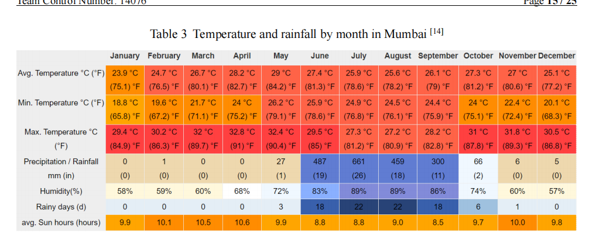
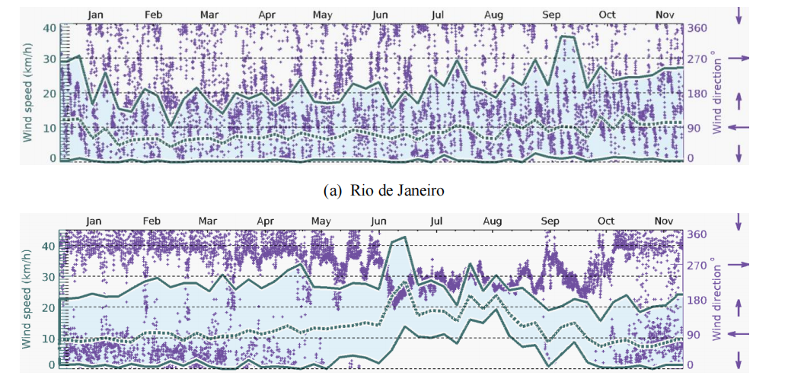
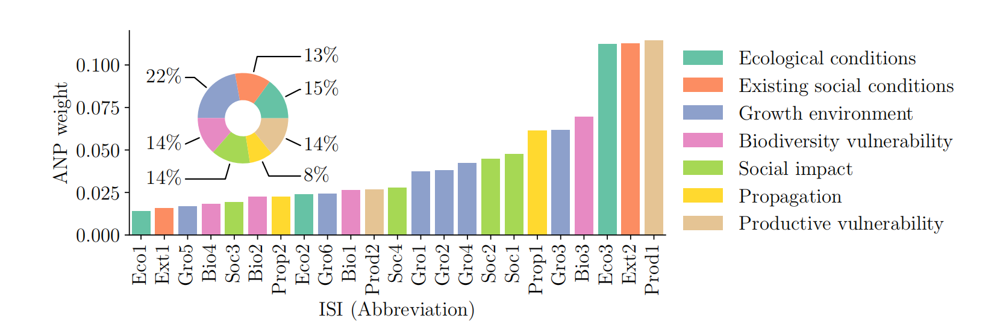
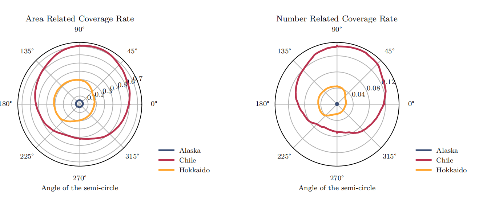
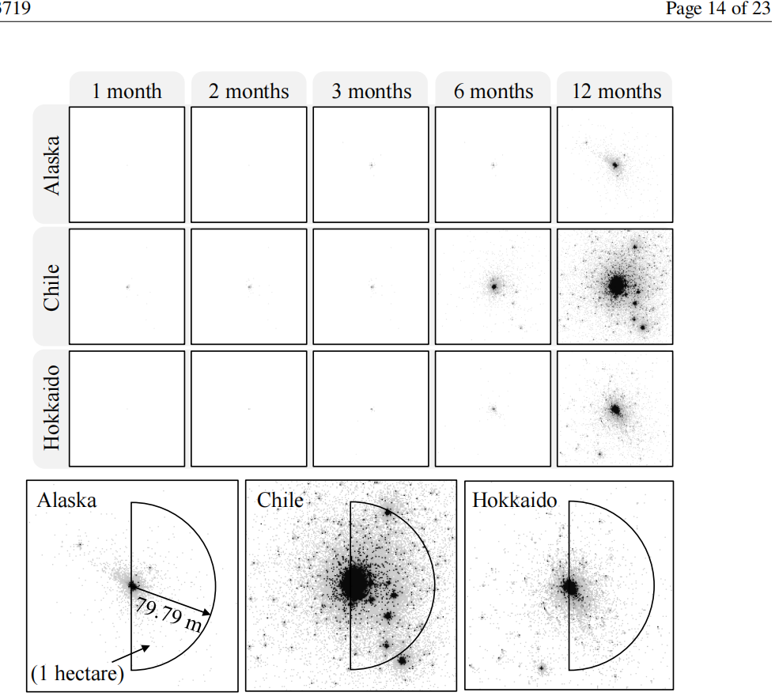
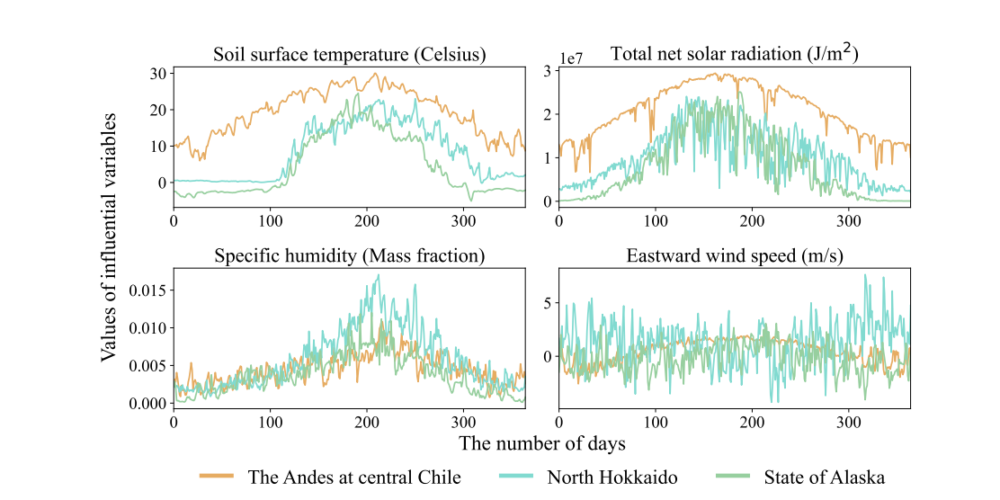
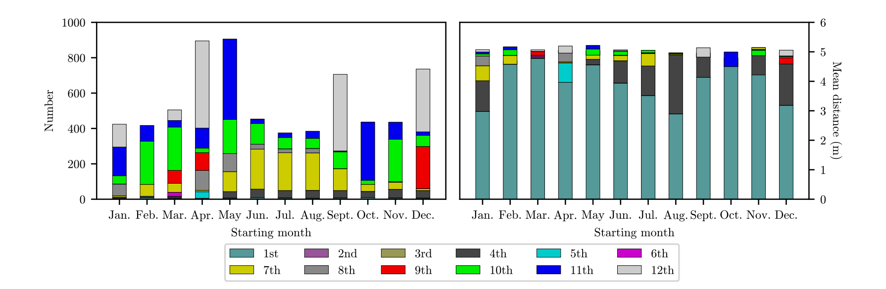
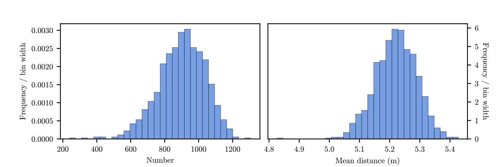

# 从参考图学习选图，而非复制图形

本模块保存用户在 2026-10-12 提供的八张截图的设计判断。用户将其指定为
O 奖论文的质量参照；截图中的来源、获奖等级、统计计算未在本模块独立认证。
它们用于内部学习，不能当作新题的数据、验证结果或可直接贴进投稿的图片。
原截图在 `../assets/exemplar-charts/`。编号与用户上传顺序一致。

新题先确定**要证明的关系、数据粒度、估计量、读者需要的比较**，再选下面
适用的设计。允许采用完全不同的图形；迁移的是表达任务与检查条件。

## 01 月度气象彩色数据表

- **为何这样画：** 月份是共同列，气象指标是行；数字供精确查阅，色彩供季节
  模式的快速扫描。适合“多变量 × 有序时期”，尤其是正文需要引用具体值时。
- **迁移：** 可用于成本/资源月表、参数情景表、区域指标表。原单位保留在行名，
  多地区则用并排表或“地区 × 月份”分面，不强塞进同一巨大表。
- **门禁：** 温度、降雨、湿度等不同单位不得共用原始数值色标。采用逐行标准化
  或逐变量范围时必须解释公式，颜色只比较该变量自身，格内仍显示原值。
  月雨量用求和、月均温用时间均值；缺失不是零。说明月份、年份与样本覆盖率。
- **可提升：** 每种变量使用合适的独立顺序色系；统一小数精度与单位，避免双单位
  挤压字体。必要时仅给关键单元格数值，完整表留附件。

## 02 风速—风向联合时间图

- **为何这样画：** 共用时间轴让持续强风、方向变化、地区季节差异可以对应。
  不同符号和颜色承担不同变量，两个地点保持同样轴定义。
- **迁移：** 适合有方向的传播、航行、污染等；更一般地，可用对齐面板展示
  “驱动强度 + 驱动状态”。不要求复制双纵轴或密集散点。
- **门禁：** 先解释每条实线/虚线是什么统计量，截图本身不能说明它们是最大值、
  均值还是分位数。风向是循环量，0° 与 360°相邻，359°和1°不能算成180°；
  声明来自/吹向、角度起点和旋转方向，方向均值需循环统计并报告集中程度。
  双轴的重叠不能作为相关性或因果证据。
- **可提升：** 优先对齐的风速带与方向点/箭头条；数据过密可按预先定义的时间窗
  汇总并保留变化范围。风玫瑰只在方向频率是目标时使用，不能替代时间信息。

## 03 排序指标权重 + 分组组成

- **为何这样画：** 排序柱定位高权重指标；同色说明所属组；环图补充组级份额。
  把“哪个指标更重”和“哪类指标合计更重”放在不同尺度上回答。
- **迁移：** 权重、资源份额、误差来源、成本组成等具有真实分组关系的数据。
  可改为有分组色的横向排序点图 + 组汇总条形图，适应长名称。
- **门禁：** 区分局部权重、全局权重和组权重；复算归一化及按组求和，份额总和
  为1的前提须成立。ANP权重不是观测效应、因果强度或显著性，方法名由实际模型决定。
  缩写必须可查，分组排序不应暗示不存在的自然顺序。
- **可提升：** 分类颜色稳定，精确标注少数关键值；环图只有在组数与份额差异可读时
  保留。需要高精度比较时改用位置编码，并补权重来源或敏感性证据。

## 04 角度—覆盖率极坐标

- **为何这样画：** 角度确有几何意义时，极坐标能把方向性、旋转窗口响应与不同
  地区曲线联系起来。面积覆盖率和数量覆盖率分开，避免二者被当作同一指标。
- **迁移：** 真实方向响应、旋转部署窗口、季节周期、检测覆盖等循环变量；普通
  无序类别用直角坐标。此截图写着“Angle of the semi-circle”，不能直接认定是风向。
- **门禁：** 必须先定义θ是传播方向还是观测窗转角，以及分子、分母和角度区间。
  两面板径向刻度不同，图形面积不能互比；首尾连线需要真实周期闭合。
  方向计数、角度概率密度和旋转窗口覆盖率是三个不同估计量。
- **可提升：** 标出方向约定、共同图例与重要角度；必要时加角度—响应折线供精确读取。
  阴影面积不得替代覆盖率数值比较。

## 05 地区 × 时间空间矩阵 + 观测窗口

- **为何这样画：** 列回答时间演化，行回答地区差异；下方放大图解释研究窗口，
  将“分布在哪里”和“统计哪些位置”连成证据链。黑白也能保留密度与几何信息。
- **迁移：** 疫情传播、森林扩张、污染、交通密度等时空过程；点、网格、等值线
  按真实数据粒度选择，主图共尺度，局部图有全域定位。
- **门禁：** 个体散点需要真实坐标，网格计数不能生成假精确点位。标明单次模拟
  或全体重复平均，不能混称。坐标、原点、边界、窗口面积及截取规则明确。
  截图的半圆窗口不适用于所有题；新题几何由题目决定，不沿用79.79 m或一公顷。
- **可提升：** 空间图稀疏时在所有可比面板使用相同局部放大范围，附全域小图。
  密集点改计数/密度网格；统一色标，附数量、占用面积或距离等互补统计。

## 06 多变量、多地区环境时间序列

- **为何这样画：** 每个变量有独立单位与纵轴，地区颜色贯穿所有面板；共用时间
  便于追踪同一地区的多种驱动，避免不同量纲曲线被压扁或假装可比。
- **迁移：** 传感器、经济、能源、生态输入等“多个量纲 × 多组 × 时间”的数据。
  每个面板围绕变量解释，不按默认表格列数填满画布。
- **门禁：** 日期、时区、采样频率与聚合规则一致；同变量跨地区可比，不同变量
  不共享纵轴。东向风速是可为负的分量，不等于非负风速。没有的变量不添加。
  平滑需说明窗口并保留突发信息；缺失数据应有断点或覆盖率说明。
- **可提升：** 主导机制给予更大面板，其他变量作支持；共享图例或末端直标，
  单位简洁、低对比曲线仍须在缩小与灰度下可辨。双轴不作为默认方案。

## 07 起始月份—结果组成堆叠图

- **为何这样画：** 起始时间是实验因素；每柱同时显示总量及其成分，左右面板
  对照不同结果指标。这不是“任何月度数据都画堆叠”。
- **迁移：** 存在互斥且完整的阶段、队列、成本项或资源来源分解时，比较起始策略。
  成分多时可用组成热图 + 总量点线，减少12种颜色与大图例的负担。
- **门禁：** 1st–12th的含义仅靠截图无法确认，必须回到数据定义。各起始策略
  采用同样的模拟时长、结果时点、重复单位与条件；数量成分必须可加并复算总量。
  平均距离不可直接按组均值堆叠；若段为贡献，则定义
  `c_g = (n_g / N) × mean_distance_g`，且 `sum(c_g) = overall_mean_distance`。
  没有这样的分解则用点/线/分面比较，不能因参考图用了堆叠便照画。
- **可提升：** 固定堆叠顺序、减少无关颜色；真实贡献与比例分开，0基线、单位和
  总量清楚，补重复模拟的不确定性而不把零结果藏掉。

## 08 数量与平均距离的结果分布

- **为何这样画：** 并排分布比较两种指标的波动形态、中心、离群与尾部；它支持
  “稳定程度有多大”，是只报均值的必要补充之一。
- **迁移：** 重复仿真、误差、成本、风险、耗时等样本结果，可配ECDF、阈值概率
  或分位点。样本很少/高度离散时用点图和ECDF，避免平滑产生假细节。
- **门禁：** 明确频数、相对频率还是概率密度；`count/bin_width`积分是样本数，
  `count/(n×bin_width)`的面积才是1。密度可超过1，不能解释为单点概率。
  声明分箱边界、样本数、独立单位与截断；截断后的条件密度不能冒充完整分布。
  零存活时平均距离可能无定义，须单独报告该比例，不得随意填0。
  钟形外观不能证明正态、置信区间或外部验证。
- **可提升：** 用共享视觉风格而非强行共享不同指标的坐标尺度；标出真实分位数
  或有决策意义的阈值，配简洁样本摘要和ECDF检查尾部。

## 跨题迁移：先找到关系，再找到图

| 新题实际关系 | 优先候选 | 需要补的证据 | 不合适的迁移 |
|---|---|---|---|
| 多单位指标与时期 | 行内归一化数据表 / 对齐时间面板 | 聚合、单位、覆盖率 | 不同量纲共原始色标 |
| 方向与驱动强度 | 方向时间条 / 风玫瑰 / 真角度响应 | 角度约定、循环统计 | 给无序类别画极坐标 |
| 局部排序与整体组成 | 排序点/柱 + 分组汇总 | 权重层级、加法/分母 | 默认所有评分都用ANP |
| 空间演变与统计范围 | 等尺度地图矩阵 + 定位图 | 几何、网格/坐标、run单位 | 为美观制造个体点 |
| 实验策略与可加结果 | 堆叠 / 成分热图 + 总量 | 相同观察时长、贡献分解 | 堆叠不同组均值 |
| 不确定结果与阈值 | 分布 + ECDF / 分位点 | 独立样本、零与尾部 | 只报均值或拟造正态 |
| 预测质量 | 预测/观测 + 区间 + 残差 | 时序划分、样本外检验 | 用漂亮曲线替代验证 |
| 优化取舍 | 可行Pareto散点 + 约束/资源诊断 | 可行解与目标、选择规则 | 连接未求得的前沿 |

这八张参考图不覆盖所有题型。遇到新题可以采用 catalog 中的拟合诊断、交互
敏感性、网络流、可行前沿等图；保留本模块的论点—编码—核验方法。
